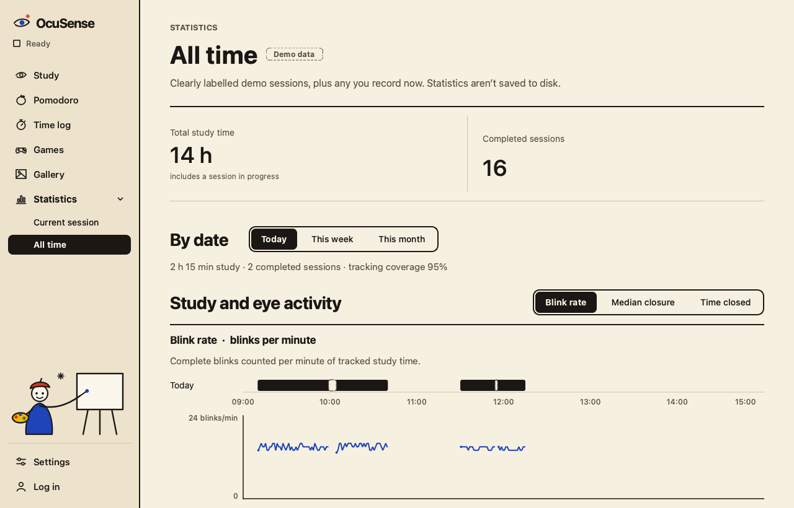
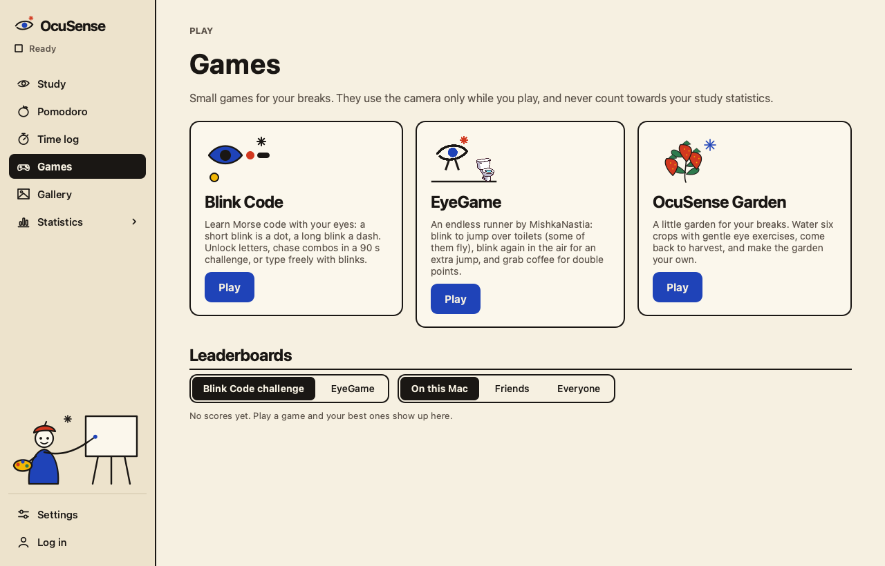
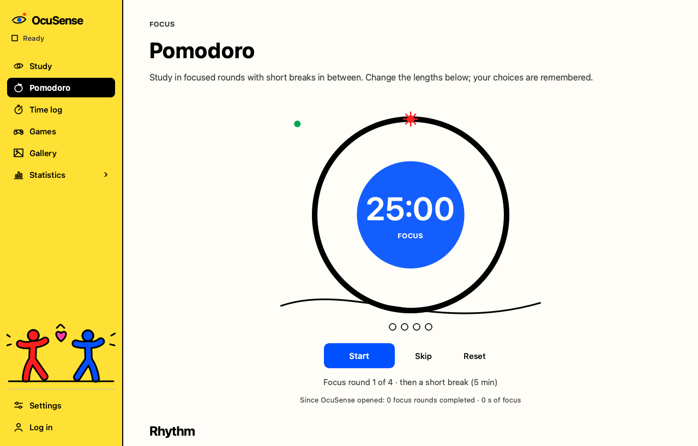

# OcuSense

**Big Brother watches you. OcuSense looks out for you.**

OcuSense is a study app for long days at your laptop. It uses your webcam to count your blinks
and reminds you to rest your eyes before they feel dry and tired. It also looks after your setup:
it tells you when you lean in too close, slump in your chair or study in a room that's too dark.
On top of that you get a Pomodoro timer, a time log, small games for your breaks and a little
garden to look after.

Camera pictures are analysed on your computer and thrown away straight away. OcuSense is a
student project, not a medical device.

<p>
  
  
  
</p>

## What it does

- **Counts your blinks.** A 25 second calibration learns your own open and closed eyes, then
  OcuSense measures blink rate, how long blinks last and how much of the time your eyes are
  closed. All of it is compared with you, never with an average person.
- **Reminds you, kindly.** "Trying to lick the screen?" when you're too close, a break reminder
  when you blink slower than usual, and optional eye rest, lighting and posture checks. They show
  in the window and as notifications when OcuSense is in the background.
- **Keeps time.** A Pomodoro timer that starts and pauses eye monitoring for you, and a time log
  for your subjects and projects.
- **Makes breaks fun.** Blink Code (Morse code with your blinks), EyeGame (an endless runner you
  play by blinking, by our teammate MishkaNastia) and OcuSense Garden (water crops with a gentle
  eye exercise and harvest them for coins).
- **Pays you in paintings.** Spend garden coins on a gallery of paintings and hang your favourites
  in the sidebar. With an account, compare game scores on the leaderboards and with friends.
- **Two looks.** Calm Miró or loud Keith Haring, switched instantly in Settings.

## Download

| System | Status |
| --- | --- |
| macOS (Apple Silicon) | Download coming soon. Build it yourself below in the meantime. |
| Windows 10 and 11 (64 bit) | Beta: built automatically, not yet tested with a real webcam. |
| Linux (x86_64) | Beta: built automatically, not yet tested with a real webcam. |

The builds aren't signed by Apple or Microsoft yet, so your computer warns you the first time you
open one. On a Mac: right click OcuSense, choose **Open**, then **Open** again.

## Privacy

- Camera pictures never leave your computer and are never saved.
- OcuSense saves numbers only, on your computer: your calibration, your settings, your garden,
  time log and game scores, and (unless you switch it off) a recording of eye measurements.
- Accounts are optional. They hold your email address, a username, your game scores and your
  friends list. Eye measurements are never uploaded.

## Run it from the source code

You need Python 3.12 or newer (the builds use 3.14).

```bash
git clone https://github.com/MishkaNastia/OcuSense.git
cd OcuSense
python3 -m venv .venv
.venv/bin/pip install -r requirements.txt     # on Windows: .venv\Scripts\pip install -r requirements.txt
.venv/bin/python -m ocusense                  # on Windows: .venv\Scripts\python -m ocusense
```

Press **Start**. The first time, macOS (or Windows) asks for the camera; after you allow it,
OcuSense calibrates and starts. To see Statistics filled with clearly labelled demo sessions, run
`python -m ocusense --demo-history`.

Run the tests (no camera needed):

```bash
QT_QPA_PLATFORM=offscreen .venv/bin/python -m unittest discover -s tests
```

## Build the apps

| System | How |
| --- | --- |
| macOS | `.venv/bin/pip install -r requirements-build.txt`, then `./packaging/build_mac.sh` (makes `OcuSense.app` and puts it on your Desktop) |
| Windows | `python packaging/build_windows.py` on Windows, or the GitHub Actions workflow **Windows build (manual)** |
| Linux | `python packaging/build_linux.py` on Linux, or the GitHub Actions workflow **Linux build (manual)** |

The GitHub workflows only run when started by hand and keep the result as a downloadable
artifact for 14 days. More in [docs/windows.md](docs/windows.md).

## The website

The website (information pages, a browser demo and the public leaderboard) lives in
[`website/`](website/README.md):

```bash
cd website && npm install && npm run dev      # then open http://localhost:3000
```

## Documentation

| Document | What's in it |
| --- | --- |
| [docs/architecture.md](docs/architecture.md) | how the measuring works, the project layout and where new work goes |
| [docs/measurements.md](docs/measurements.md) | every measurement and graph in depth |
| [docs/accounts.md](docs/accounts.md) | accounts, leaderboards, friends and the Supabase setup |
| [docs/garden.md](docs/garden.md) | OcuSense Garden |
| [docs/gallery-paintings.md](docs/gallery-paintings.md) | the Gallery paintings |
| [docs/windows.md](docs/windows.md) | the Windows version |
| [docs/evaluation-checklist.md](docs/evaluation-checklist.md) | testing the measurements with real people |

## Who made it

A hackathon project on student and campus life by computer science engineering, life sciences
engineering and data science students. EyeGame started as a separate game by MishkaNastia
([MishkaNastia/EyeGame](https://github.com/MishkaNastia/EyeGame)).

## Licence

The OcuSense source code is released under the [MIT licence](LICENSE).

Some files keep their own terms:
- **Face tracking model** (`models/face_landmarker.task`): Google's MediaPipe Face Landmarker,
  Apache License 2.0 (see [models/README.md](models/README.md)).
- **Paintings by other artists** in the Gallery: public domain images from The Metropolitan
  Museum of Art's Open Access program, listed in [docs/gallery-paintings.md](docs/gallery-paintings.md).
- **Other artwork** in `ocusense/assets/` isn't covered by the MIT licence unless stated.
